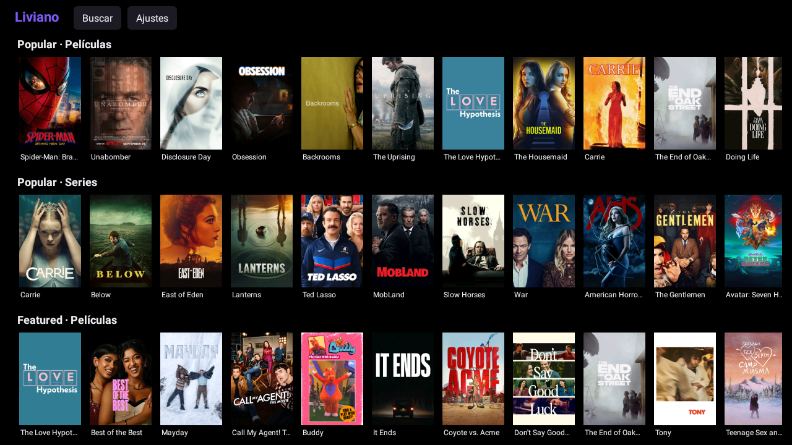
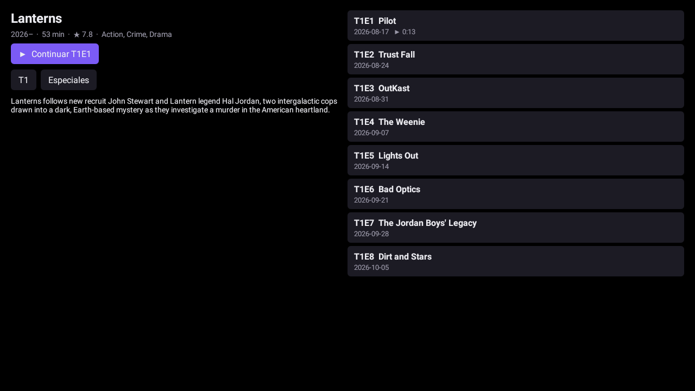

# Liviano

Cliente **liviano** para Android TV compatible con los **addons de Stremio**, pensado para teles baratas con poca RAM (512 MB – 1 GB).

Usa tu misma cuenta de Stremio: tus addons, tu biblioteca y "Seguir viendo" se sincronizan. La interfaz es nativa (sin WebView) y el reproductor usa la decodificación por hardware de la tele.




| | Stremio oficial | Liviano |
|---|---|---|
| Tamaño instalado | ~290 MB | **~3 MB** |
| RAM en el inicio | 150 MB+ | **~25 MB** |
| RAM reproduciendo 1080p | — | **~90–100 MB** |
| Torrents | dentro de la tele | en un servidor aparte (tu PC) o vía debrid |

> Medido en una tele "Android TV S1" (HiSilicon Hi3751V350, Android 9, 512 MB de RAM).

## Qué hace

- Inicio de sesión con la cuenta de Stremio (`api.strem.io`): addons instalados, biblioteca y progreso sincronizados.
- Catálogos, búsqueda, fichas con temporadas y episodios, lista de fuentes de todos los addons.
- Reproductor Media3/ExoPlayer: video por hardware (H.264, HEVC, VP9) y audio AC3/E-AC3/DTS/TrueHD por software (FFmpeg) cuando la tele no lo soporta.
- Subtítulos de los addons (OpenSubtitles, etc.) y los incluidos en el archivo; elige automáticamente tu idioma.
- Retoma donde lo dejaste.
- Mantener OK sobre una fuente la abre en el reproductor externo de la tele.

**No incluye** motor de torrents: las fuentes torrent se reproducen a través de un servidor de streaming de Stremio corriendo en otra máquina de tu red (ver abajo), o usando un servicio debrid en tu addon (en ese caso las fuentes ya son links HTTP directos).

## Cómo funciona

```
 Tele (Liviano)                      Internet
 ┌────────────────────┐   JSON   ┌────────────────────────┐
 │ catálogos / fichas │ ───────► │ addons (Cinemeta,       │
 │ fuentes / subs     │          │ Torrentio, OpenSubs…)   │
 │                    │          └────────────────────────┘
 │ ExoPlayer ◄────────┼── HTTP ── link directo (debrid / HTTP)
 │           ◄────────┼── HTTP ── PC: servidor Stremio :11470 ◄── P2P (torrent)
 └────────────────────┘
```

Liviano habla el [protocolo público de addons de Stremio](https://github.com/Stremio/stremio-addon-sdk/blob/master/docs/protocol.md) (`/manifest.json`, `/catalog`, `/meta`, `/stream`, `/subtitles`). No reutiliza código de Stremio.

## Instalación

### 1. Preparar la tele

1. **Ajustes → Preferencias del dispositivo → Información** → pulsa **Compilación** 7 veces para activar las opciones de desarrollador.
2. En **Opciones de desarrollador** activa **Depuración USB** (en muchas teles también habilita ADB por red, puerto 5555) o **Depuración inalámbrica**.
3. Anota la IP de la tele (Ajustes → Red).

### 2. Compilar e instalar

Necesitas JDK 17, Android SDK (plataforma 35) y `adb`.

```bash
git clone https://github.com/parkerbfb/liviano-tv.git
cd liviano-tv
echo "sdk.dir=$HOME/Android/Sdk" > local.properties
./scripts/install-tv.sh 192.168.1.50     # IP de tu tele
```

O instala a mano el APK de [Releases](../../releases): `adb install app-release.apk`.

### 3. (Opcional) Servidor para torrents en tu PC

Si tus fuentes son torrent y no usas debrid, instala el servidor de streaming de Stremio en una PC Linux de la misma red (necesita Node.js, no necesita sudo):

```bash
./server/install.sh
```

Queda como servicio `systemd --user` que arranca solo. Después, en la tele: **Liviano → Ajustes → Servidor de torrents** → `http://IP-DE-TU-PC:11470`.

> El script descarga `server.js` directamente desde `dl.strem.io`; este repositorio no lo redistribuye.

### 4. Usar

**Ajustes → Cuenta de Stremio** → inicia sesión. Listo.

| Control | Acción |
|---|---|
| OK | abrir / reproducir |
| Mantener OK (en una fuente) | abrir en el reproductor externo |
| Menú (durante el video) | elegir subtítulos |
| Engranaje del reproductor | pista de audio, velocidad |

## Aligerar una tele lenta (opcional)

Con poca RAM ayuda quitar animaciones y apps de fábrica que no uses. `scripts/aligerar-tele.sh` hace esto de forma **reversible** (`pm uninstall --user 0` no borra la app del sistema):

```bash
adb connect IP:5555 && adb shell pm list packages     # mira qué tiene tu tele
./scripts/aligerar-tele.sh IP com.android.traceur com.android.bips com.android.gallery3d
# revertir: adb shell cmd package install-existing <paquete>
```

No quites el launcher, los servicios de Google, la Play Store ni los servicios del fabricante (imagen, sintonizador, control remoto). Si dudas, no lo quites.

## Estructura

```
app/src/main/java/dev/liviano/tv/
  MainActivity      inicio: "Seguir viendo" + catálogos
  SearchActivity    búsqueda en catálogos con extra "search"
  DetailActivity    ficha, temporadas, episodios
  StreamsActivity   fuentes de todos los addons
  PlayerActivity    ExoPlayer + subtítulos + progreso
  SettingsActivity  cuenta, addons, idioma, servidor
  Addon             manifest y resolución de recursos del protocolo
  Lib               API de Stremio: login, addons, biblioteca
  Net / Img / Store / Ui   HTTP, pósters, preferencias, vistas
server/             instalador del servidor de streaming (PC Linux)
scripts/            compilar+instalar, aligerar la tele
```

Decisiones de diseño: Java + vistas por código (sin Compose, AppCompat ni Leanback) para que el APK y la RAM sean mínimos; búfer del reproductor limitado a 48 MB; pósters en RGB_565 submuestreados.

## Aviso

Liviano es un proyecto independiente, **no afiliado a Stremio**. No aloja ni distribuye contenido: solo muestra lo que devuelven los addons que el usuario instala. Cada usuario es responsable de los addons que usa y de respetar las leyes de su país.

## Licencia

[GPL-3.0](LICENSE). Usa [Media3](https://github.com/androidx/media) (Apache-2.0) y el decodificador FFmpeg de [Jellyfin](https://github.com/jellyfin/jellyfin-androidx-media) (GPL-3.0).
